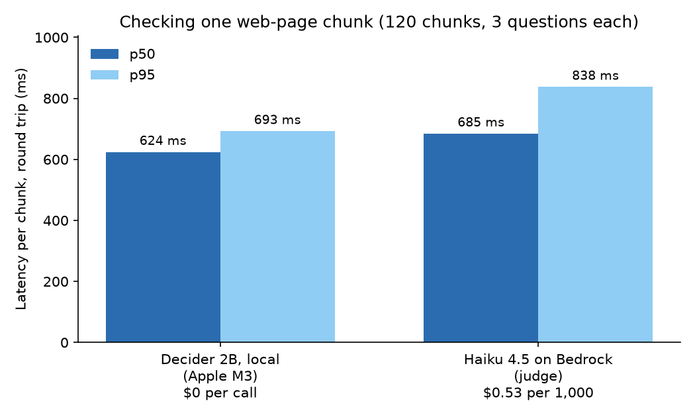

# Benchmarks

## Decider 2B baseline latency

How long one guardrail decision takes: one yes/no question about one web-page chunk, against a warm local server.

| Metric | Value |
| --- | --- |
| p50, server-side | **314 ms** |
| p50, including the HTTP round trip | 316 ms |
| Range over 10 runs (server-side) | 310–316 ms |
| Input tokens per request | 176 |

Measured on 2026-10-18 with `eval/bench_decider_latency.py`: 2 warm-up runs, then 10 measured runs. Every run sends a different chunk, so the server's prefix cache cannot reuse earlier work. Raw output: [`eval/results/decider_latency.json`](../eval/results/decider_latency.json).

### Setup

| | |
| --- | --- |
| Hardware | Apple M3 (base chip), 16 GB unified memory, MacBook |
| OS | macOS 15.7.1 |
| Decider | `strands-decider` 0.1.0 from PyPI, PyTorch on the `mps` device |
| Model | `StrandsAgents/strands-decider-2B-qwen3.5-v1-2610` (base `Qwen/Qwen3.5-2B-Base`), 4096-token window |

### Context

- Upstream reports a 153 ms warm median on an M3 Pro for tasks under 300 tokens, and 115 ms on an RTX 3090 ([strands-decider README](https://github.com/strands-labs/strands-decider#performance)). The base M3 has fewer GPU cores than the M3 Pro, which fits our roughly 2x figure.
- Upstream's MLX backend (`--device mlx`) is 1.4–1.6x faster than MPS on Apple silicon. It is not in the 0.1.0 release on PyPI yet.
- Latency grows roughly linearly with input tokens, so chunk size is the main lever we control.
- The first request at a new input length is slower on Apple silicon (a one-off kernel compile). The warm-up runs absorb it here; in the agent, expect the first few chunks of a session to be slower.

### Reproduce

```bash
uv tool install strands-decider
strands-decider serve StrandsAgents/strands-decider-2B-qwen3.5-v1-2610 --port 8099
uv run python -m eval.bench_decider_latency --runs 10
```

## Decider 2B against Bedrock as judge

How long it takes, and what it costs, to check one web-page chunk the way the scanner does: the deobfuscated text and the three chunk questions in one request, over the 120 chunks of the evaluation dataset. Haiku 4.5 got the same input in the Bedrock-as-judge baseline ([bedrock-baseline.md](bedrock-baseline.md)). Its numbers come from that run's CSV, and both sides go through the same percentile function.



| Per chunk | Decider 2B, local on an Apple M3 | Haiku 4.5 on Bedrock |
| --- | --- | --- |
| p50 / p95, round trip | **624 / 693 ms** | **685 / 838 ms** |
| p50 / p95, server side | 623 / 692 ms | 600 / 715 ms |
| p50 / p95, first pass of a fresh session | 645 / 761 ms | not measured |
| Input tokens | 330 | 325, plus 32 out |
| **Cost per 1,000 chunks** | **$0 per call**, plus 10.5 min of machine time | **$0.53** |

Generated table: [`eval/results/latency_cost.md`](../eval/results/latency_cost.md). Per-chunk timings: [`eval/results/latency_cost.csv`](../eval/results/latency_cost.csv).

### Reading it

- **About as fast.** On the M3, Decider answers in about the time Haiku takes over the network.
  - **Server side is the fairest comparison:** 623 ms against 600 ms at p50. About 85 ms of Haiku's round trip is the network between Mexico and `us-east-1`. That row is the one to quote.
  - The one-question baseline above took 314 ms on a shorter text (176 tokens); this request has three questions and 330 tokens.
- **Different cost model.**
  - **Bedrock** charges per token, so the bill grows with every chunk.
  - **Decider** has no per-call price; the cost is the machine it runs on.
  - **Break-even:** a machine rented by the hour costs less than the judge once it scans more than its hourly price divided by $0.000534. For an `m7i.xlarge` at $0.2016/h, that's **378 chunks per hour**, as long as it takes under 9.5 s per chunk.
  - **Unmeasured:** we didn't measure Decider's speed on that instance. On the M3 it takes 0.62 s, so the bar leaves room for a CPU about 15 times slower.
  - **Concurrency:** chunks per hour is a throughput, and both sides were measured one request at a time. Decider's server has 24 slots and Bedrock takes parallel calls, so either side could do more per hour; that wasn't measured.
- **Cold start.** The first pass of a fresh session is slower at p95 (761 ms): on Apple silicon, the first request at each new input length compiles kernels. Every chunk is different, so the scanner's cache plays no part here.
- **Accuracy** is in [bedrock-baseline.md](bedrock-baseline.md): both catch about the same number of attacks, and Haiku makes fewer false alarms (0/60 against 3/60).

### Setup and caveats

- **Decider:** `strands-decider` 0.1.0 on the `mps` device, on the same Apple M3 (16 GB) as above. The server's prefix cache is on, its default and how the scanner runs it. The chunks were sent twice; the table reports the second pass.
- **Haiku:** `us.anthropic.claude-haiku-4-5-20251001-v1:0`, from the run of 2026-10-22 in `eval/results/bedrock_judge.csv`. That's one Converse call per chunk from a laptop in Mexico to `us-east-1`, so about 85 ms of the round trip is network (685 ms round trip against 600 ms server side, at p50).
- **Scope:** one machine and one run each, one request at a time. Percentiles are linear between closest ranks (numpy's default) on both sides; nearest-rank would put Haiku's p95 at 846 ms.

### Reproduce

```bash
strands-decider serve StrandsAgents/strands-decider-2B-qwen3.5-v1-2610 --port 8099
uv run python -m eval.bench_vs_bedrock                                  # about 3 minutes
uv run --with matplotlib python -m eval.bench_vs_bedrock --plot-only    # redraw the chart
```
